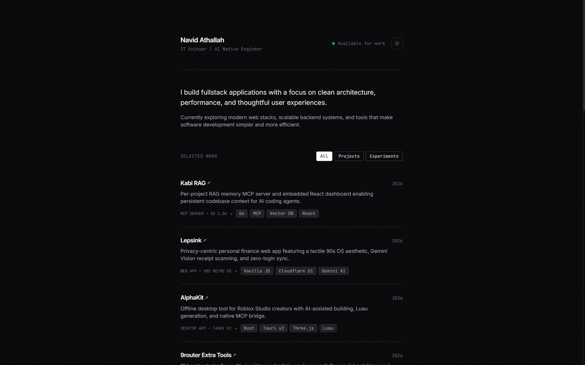

# Portfolio — Navid Athallah

A single-page personal portfolio built with plain HTML, CSS, and JavaScript. The design is deliberately minimal: a monochrome palette, restrained typography, and no runtime dependencies.



## Overview

The site presents a complete professional profile on one page:

- Profile and availability status
- Selected work with category filters (All / Projects / Experiments)
- Experience, education, licenses and certifications, and toolkit
- Contact details with copy-to-clipboard support

It also includes a custom canvas ink cursor, a View Transitions theme switch, scroll-reveal animations, and an ambient paper texture. All motion is disabled when the visitor prefers reduced motion.

## Tech stack

| Layer | Details |
| --- | --- |
| Markup | HTML5 |
| Styling | CSS3, Tailwind CSS 3 (precompiled) |
| Behavior | Vanilla JavaScript (ES2020+) |
| Fonts | Inter and JetBrains Mono (self-hosted, latin subset) |
| Hosting | Any static file host; `_headers` provided for Cloudflare Pages |

There is no build step and no package manager is required to run the site. Tailwind is compiled ahead of time into a single ~13 KB stylesheet.

## Project structure

```text
.
├── index.html                  Page markup and all static content
├── assets/
│   ├── css/
│   │   ├── main.css            Theme tokens, cursor, animations, components
│   │   ├── fonts.css           @font-face declarations
│   │   └── tailwind.css        Compiled Tailwind output (do not edit)
│   ├── js/
│   │   └── main.js             Projects data, filtering, theme, ink cursor
│   ├── fonts/                  Self-hosted Inter and JetBrains Mono
│   └── icons/                  Favicons
├── docs/
│   ├── README.md               Detailed project documentation
│   ├── thumbnail.png           Social/preview image
│   ├── screenshots/            Desktop and mobile screenshots
│   └── licenses/               Font licenses (SIL OFL 1.1)
├── _headers                    Security and cache headers for Cloudflare Pages
├── tailwind.config.js          Tailwind configuration
├── tailwind.input.css          Tailwind entry point
├── CHANGELOG.md
└── LICENSE
```

## Getting started

### Preview locally

The quickest option is to open `index.html` directly in a browser. Some browsers block custom fonts for `file://` pages, so use a local server for a preview that matches production.

```bash
python -m http.server 8090
```

Then open <http://localhost:8090>. Any static file server works.

## Customization

### Page content

Profile, experience, education, certifications, toolkit, and contact information are written directly in `index.html`.

### Projects

The project list is defined in the `PROJECTS` array in `assets/js/main.js`:

```javascript
{
  id: "project-id",
  title: "Project name",
  category: "projects", // "projects" or "experiments"
  year: "2026",
  description: "A short, factual summary of the project.",
  tags: ["TypeScript", "React", "Cloudflare"],
  link: "https://github.com/example/project",
  previewHint: "Web App • React"
}
```

### Styling

- `assets/css/main.css` contains the theme tokens, ink cursor, reveal animations, filter states, and other custom styles.
- `assets/css/tailwind.css` is generated output. Do not edit it manually.
- `assets/css/fonts.css` declares the self-hosted fonts.

### Rebuilding Tailwind

Regenerate the stylesheet after adding or removing utility classes in `index.html` or `assets/js/main.js`:

```bash
npx tailwindcss@3 -c tailwind.config.js -i tailwind.input.css -o assets/css/tailwind.css --minify
```

The command downloads the Tailwind CLI temporarily; nothing is installed globally.

### Fonts

Place any additional `.woff2` files in `assets/fonts/`, add the corresponding `@font-face` rules in `assets/css/fonts.css`, and update the preload links in `index.html`.

## Accessibility

- Semantic sectioning and heading order
- `aria-pressed` states on project filters and `aria-controls` on their trigger buttons
- `role="status"` and `aria-live` for copy feedback
- Full `prefers-reduced-motion` support
- `<noscript>` fallback so content remains visible without JavaScript

## Deployment

The site is fully static. Use the repository root as the publish directory, leave the build command empty, and set the output directory to `/`.

- **Cloudflare Pages** — `_headers` is applied automatically for CSP, HSTS, and asset caching.
- **GitHub Pages, Netlify, Vercel** — deploy the repository root. Custom response headers from `_headers` are Cloudflare-specific.

## Documentation

See [`docs/README.md`](docs/README.md) for a detailed content map, implementation notes, and screenshots. Changes are recorded in [`CHANGELOG.md`](CHANGELOG.md).

## License

Copyright © 2026 Navid Athallah. All rights reserved.

This repository is published for viewing and evaluation only. No permission is granted to copy, modify, redistribute, sublicense, or reuse the work, in whole or in part, without prior written permission. See [`LICENSE`](LICENSE) for the full terms.

## Contact

- Email: [navidvkt@gmail.com](mailto:navidvkt@gmail.com)
- GitHub: [@enpidi26](https://github.com/enpidi26)
