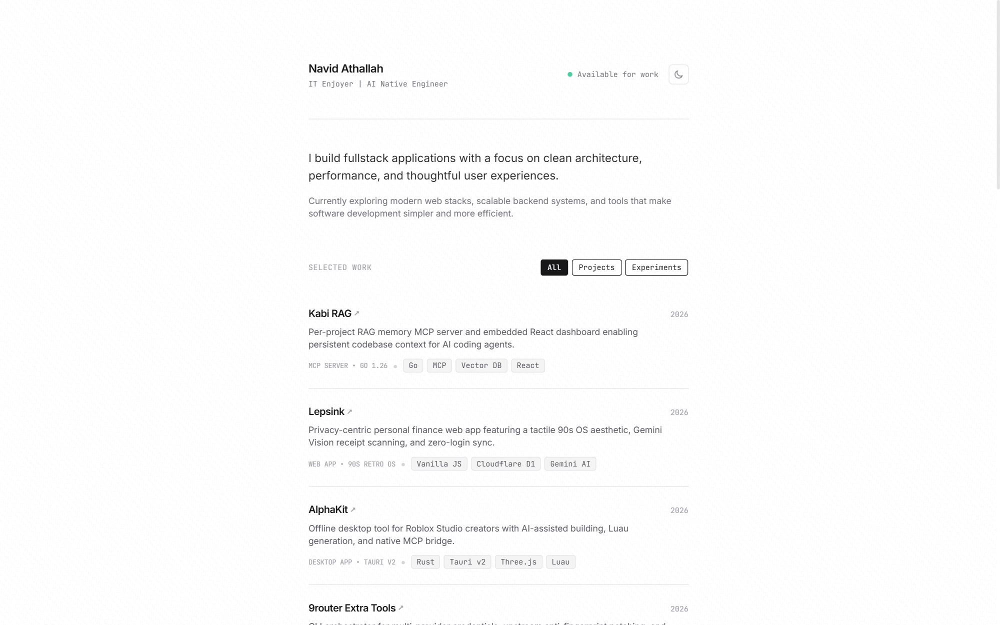

# Project Documentation — Portfolio


This document describes the site's content, interface behavior, and maintenance workflow. For setup, customization, and deployment, see the [root README](../README.md).

## Page content

The portfolio is a single scrolling page:

- **Profile** — name, role, availability status, and a short introduction.
- **Selected Work** — six projects with All / Projects / Experiments filters.
- **Experience, Education, Licenses & Certifications, Toolkit** — includes 17 certifications, ordered newest first.
- **Contact** — email address, copy button, and social links.

## Implementation notes

### Ink cursor

The cursor is drawn on a full-screen canvas above the page. It consists of a solid center dot, a translucent halo that expands over links and buttons, and a calligraphic trail that fades over 700 ms. On touch devices it follows the finger and fades out after release. Rendering pauses when the cursor is hidden or the pointer is idle, keeping idle CPU usage near zero.

### Theme transition

The theme switch uses the View Transitions API. On desktop, a circular ink bloom expands from the toggle button; on viewports 768 px and narrower, it is replaced with a short crossfade. The selected theme is stored in `localStorage` and applied by an inline script in `<head>` before first paint to prevent a flash of the wrong theme. Browsers without View Transitions fall back to a CSS color transition.

The project filter, copy-to-clipboard feedback, and scroll-reveal animations are implemented in vanilla JavaScript. All motion is disabled when `prefers-reduced-motion` is active.

## Technology

- **Tailwind CSS** is precompiled into `assets/css/tailwind.css` (~13 KB) so the browser never downloads the in-browser compiler (~400 KB).
- **Inter and JetBrains Mono** are self-hosted in `assets/fonts/` (latin subset, ~80 KB total) and preloaded from `index.html`. No requests are made to Google Fonts or any other third party.
- **Security headers** for Cloudflare Pages live in `_headers` and cover CSP, HSTS, frame protection, MIME sniffing, and referrer policy.
- Local measurements: first paint in roughly 100 ms, idle CPU near 0%, and no layout shift.

## Running locally

Open `index.html` directly, or serve the directory:

```bash
python -m http.server 8090
```

Then open <http://localhost:8090>. A local server is recommended because browsers can block custom fonts on `file://` pages.

## Deployment

The site is static and can be uploaded to Cloudflare Pages, GitHub Pages, Vercel, or Netlify. With Cloudflare Pages, `_headers` is applied automatically.

## Content updates

- **Projects** — edit the `PROJECTS` array in `assets/js/main.js`.
- **Experience, education, and certifications** — edit `index.html`.
- **Tailwind utilities** — after adding or removing classes, regenerate the stylesheet:

```bash
npx tailwindcss@3 -c tailwind.config.js -i tailwind.input.css -o assets/css/tailwind.css --minify
```

## Project structure

```text
index.html                  Page markup and static content
assets/css/main.css         Theme, cursor, animations, and custom styles
assets/css/fonts.css        @font-face declarations
assets/css/tailwind.css     Compiled Tailwind output (do not edit)
assets/js/main.js           Projects data, filtering, theme, and ink cursor
assets/fonts/               Self-hosted fonts (latin subset)
assets/icons/               Favicons
docs/                       Documentation, screenshots, thumbnail, font licenses
docs/licenses/              Inter and JetBrains Mono licenses (SIL OFL 1.1)
_headers                    Security and cache headers for Cloudflare Pages
tailwind.config.js          Tailwind configuration
tailwind.input.css          Tailwind entry point
```

## Screenshots

| Desktop (dark) | Desktop (light) |
| --- | --- |
|  |  |

| Mobile (dark) |
| --- |
|  |

## License

Copyright © 2026 Navid Athallah. All rights reserved. The repository is published for viewing and evaluation only; it may not be copied, modified, redistributed, or reused without prior written permission. See [`../LICENSE`](../LICENSE).
