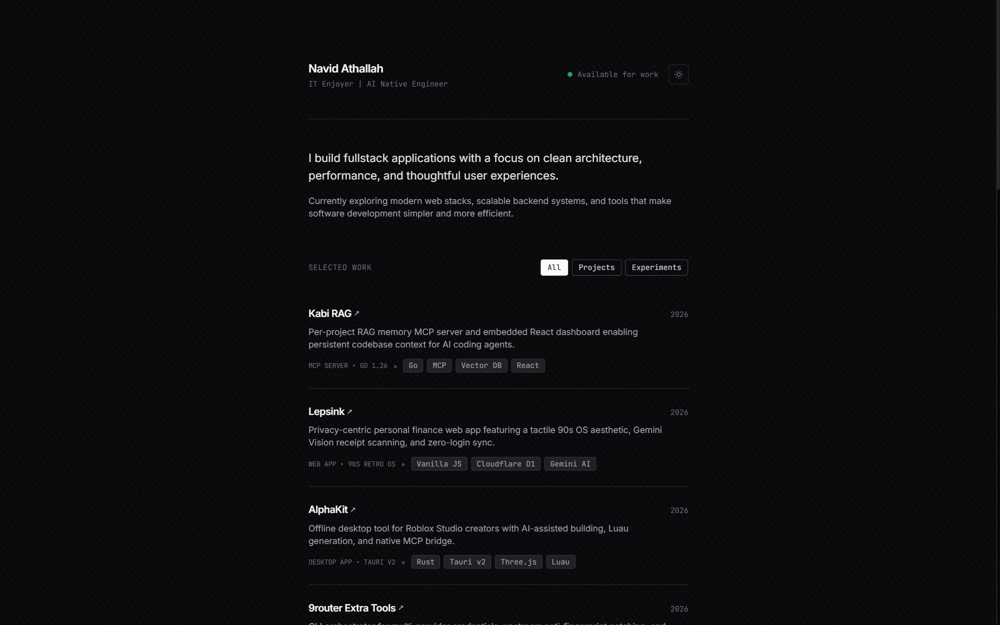
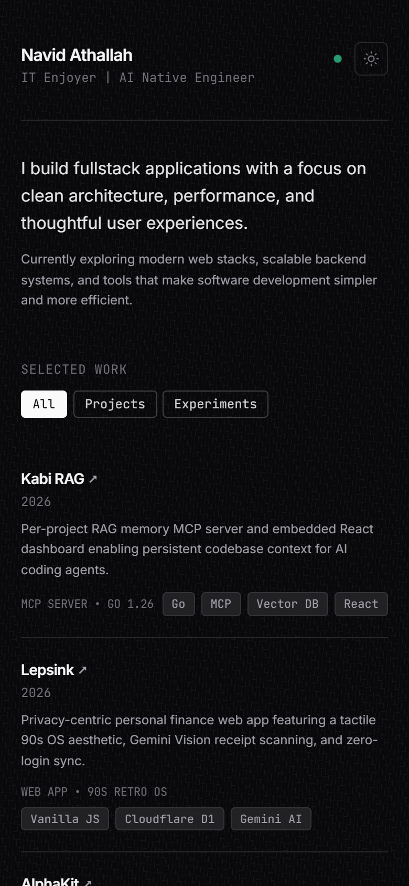

# Portfolio Web — Navid Athallah


Dokumen ini menjelaskan website portofolio saya secara singkat: apa isinya, bagaimana cara kerjanya, dan bagaimana merawatnya ke depan.

Portofolio ini sengaja dibuat sebagai satu halaman. Di dalamnya terdapat profil, proyek, pengalaman, pendidikan, sertifikat, dan kontak. Pembaca tidak perlu berpindah halaman — cukup menggulir dari atas ke bawah. Tautannya cocok dipakai di bio, dilampirkan pada CV, atau dikirimkan kepada perekrut.

## Isi halaman

- **Profil** — nama, peran, status ketersediaan, dan pengantar singkat.
- **Selected Work** — enam proyek, dengan filter All / Projects / Experiments.
- **Experience, Education, Licenses & Certifications, Toolkit** — termasuk 17 sertifikat yang diurutkan dari yang terbaru.
- **Contact** — alamat email, tombol salin, dan tautan sosial.

## Dua detail yang saya perhatikan

**Kursor tinta.** Kursor digambar langsung di atas canvas: terdapat titik, lingkaran cahaya yang membesar ketika diarahkan ke tautan atau tombol, serta jejak kaligrafi yang memudar perlahan. Di perangkat sentuh, efeknya mengikuti jari dan menghilang dengan sendirinya setelah jari diangkat. Ketika tidak digunakan, proses gambarnya berhenti sehingga tidak membebani CPU.

**Transisi tema.** Ketika tema diganti, lingkaran tinta mengembang dari tombol pengubah tema menggunakan View Transitions API. Pada layar sempit, efeknya diganti menjadi crossfade agar tetap nyaman dilihat. Pilihan tema disimpan, sehingga tetap sama ketika halaman dibuka kembali.

Selain itu, terdapat filter proyek, tombol salin email, dan animasi kemunculan saat menggulir. Seluruh animasi otomatis dinonaktifkan apabila pengunjung mengaktifkan pengaturan *reduce motion*.

## Teknologi

Website ini dibangun dengan HTML, CSS, dan JavaScript tanpa framework. Tidak ada proses build dan tidak ada `npm install`; file-nya dapat langsung dibuka.

- **Tailwind** sudah dikompilasi menjadi satu file di `assets/css/tailwind.css` (sekitar 13 KB), sehingga browser tidak perlu memuat compiler berukuran 400 KB.
- **Inter dan JetBrains Mono** disimpan sendiri di `assets/fonts/` (subset latin, sekitar 80 KB) dan di-preload dari `index.html`. Tidak ada permintaan ke Google Fonts ketika halaman dibuka.
- **Header keamanan** tersedia di `_headers` untuk Cloudflare Pages, mencakup CSP, HSTS, dan lain-lain.
- Berdasarkan pengukuran di server lokal: halaman pertama tampil dalam sekitar 100 ms, penggunaan CPU saat diam sekitar 0%, dan tidak ada pergeseran tata letak.

## Cara membuka

Cara paling cepat adalah membuka `index.html` langsung dengan klik dua kali.

Apabila ingin mencoba dengan kondisi yang sama seperti di produksi, jalankan server lokal:

```bash
python -m http.server 8090
```

kemudian buka `http://localhost:8090`.

## Deploy

Karena seluruhnya berupa file statis, folder ini dapat diunggah ke Cloudflare Pages, GitHub Pages, Vercel, atau Netlify. Apabila menggunakan Cloudflare Pages, file `_headers` akan diterapkan secara otomatis.

## Mengubah konten

- **Daftar proyek** berada pada array `PROJECTS` di `assets/js/main.js`.
- **Teks pengalaman, pendidikan, dan sertifikat** berada di `index.html`.
- Apabila menambahkan class Tailwind baru, jalankan proses kompilasi sekali:

  ```bash
  npx tailwindcss@3 -c tailwind.config.js -i tailwind.input.css -o assets/css/tailwind.css --minify
  ```

  npx hanya mengunduh sementara dan tidak memasang apa pun secara permanen.

## Struktur folder

```text
index.html                  halaman dan seluruh konten
assets/css/main.css         gaya kustom: tema, kursor, animasi
assets/css/fonts.css        @font-face font self-hosted
assets/css/tailwind.css     Tailwind hasil kompilasi (jangan diedit manual)
assets/js/main.js           data proyek, filter, tema, kursor tinta
assets/fonts/               font yang disimpan sendiri (subset latin)
assets/icons/               favicon
docs/                       dokumentasi, screenshot, thumbnail, lisensi font
docs/licenses/              lisensi Inter & JetBrains Mono (SIL OFL 1.1)
_headers                    header keamanan & cache untuk Cloudflare Pages
tailwind.config.js          konfigurasi untuk kompilasi ulang
tailwind.input.css          entry point Tailwind
```

## Tangkapan layar

| Desktop (gelap) | Desktop (terang) |
| --- | --- |
|  |  |

| Mobile (gelap) |
| --- |
|  |

---

Kode dan konten di repositori ini dilindungi hak cipta. Repositori bersifat publik hanya untuk dilihat dan dievaluasi — bukan untuk dipakai ulang. Selengkapnya: [`../LICENSE`](../LICENSE).
